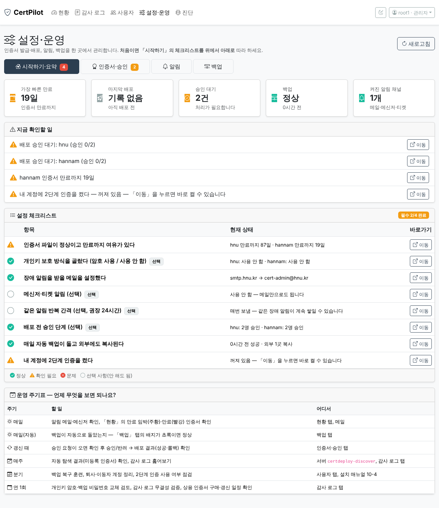
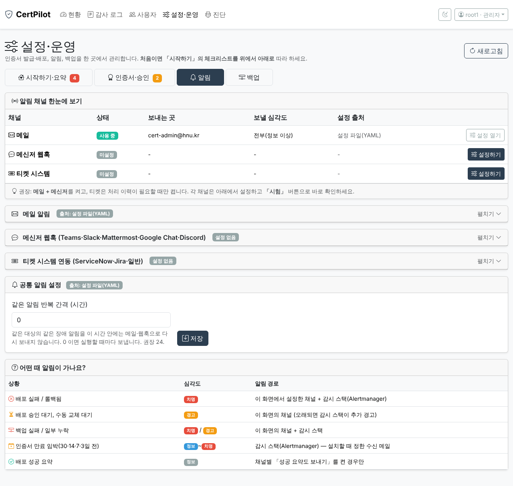

# 🚀 원스톱 시작 가이드 — 처음 오신 분은 여기부터

> 이 문서만 따라 하면 **서버 1대에 설치 → 첫 설정 → 매일 운영**까지 갑니다. 자세한 명령·원리는 [설치·테스트 매뉴얼](vm-install-and-test.md)에 있고, 이 문서는 "무엇을 어떤 순서로"만 다룹니다.
> 표기: ✅ 정상 · ⚠️ 확인 필요 · ❌ 문제 · ⬜ 선택(안 해도 됨) · 🖥 서버에서 · 🌐 브라우저에서

## 1. 이 시스템이 해 주는 일

| | 기능 | 한 줄 설명 | 어디서 보나 |
|---|---|---|---|
| 🔭 | **감시** | 서버 50대 이하의 인증서 만료일을 5분마다 확인, 30·14·7·3일 전 알림 | Grafana(`https://서버/`), 메일 |
| 🔐 | **발급·반입** | 상용 인증서(CSR → 반입) 또는 Let's Encrypt 자동 발급(DNS-01) | 서버 `certdeploy` 명령 |
| 🚀 | **자동 배포** | 에이전트 설치 없이 SSH/API로 Apache·Tomcat·IIS·WebtoB·JEUS·웹방화벽에 반영, **실패하면 자동 롤백** | 관리자 화면 · 메일 |
| ✋ | **승인(선택)** | 갱신본을 반영하기 전에 담당자 1~3명 승인 | 관리자 화면 「인증서·승인」 |
| 🔎 | **자동 탐색** | 우리 대역에서 감시 목록에 없는 인증서를 찾아냄(읽기 전용) | 서버 `certdeploy-discover` |
| 🔔 | **알림** | 메일 · Teams/Slack 등 메신저 · ServiceNow/Jira 티켓 | 관리자 화면 「알림」 |
| 💾 | **백업** | 매일 암호화 백업·검증·외부 복사, 새 서버로 복구 | 관리자 화면 「백업」 |
| 🛡 | **보안** | 개인 계정 + 2단계 인증, 변조 방지 감사 로그, 개인키 암호 보호(선택) | 관리자 화면 |

## 2. 어디서부터? (역할별 길 안내)

| 나는… | 이렇게 | 문서 |
|---|---|---|
| 🛠 **처음 설치하는 담당자** | 이 문서 3~5장 → 시험 | 이 문서, [테스트 시나리오](test-scenarios.md) |
| 👀 **매일 운영하는 담당자** | 6~8장 | 이 문서, 화면 안의 「설정·운영 → 시작하기」 |
| 🧯 **문제가 생겼다** | 8장 증상표 → 진단 탭 → 진단 번들 | [디버깅 가이드](debugging.md) |
| 🔬 **자세한 원리·명령이 필요** | 상세 매뉴얼 | [설치·테스트 매뉴얼](vm-install-and-test.md) |
| 📋 **결정할 것·요청할 것 정리** | 준비 체크리스트 | [pre-vm-checklist](pre-vm-checklist.md) |

## 3. 준비물 (설치 전 10분 점검)

| 항목 | 값/요건 | 확인 |
|---|---|---|
| 🖥 VM | Rocky Linux **10.x**, CPU 2~4, 메모리 8GB, 디스크 60GB 이상, **x86-64-v3 CPU**(VMware EVC 확인) | ⬜ |
| 🌐 인터넷 | `download.docker.com`, `registry-1.docker.io`, `pypi.org`, `github.com` 접속 가능(막혀 있으면 [반입 절차](vm-install-and-test.md)) | ⬜ |
| 🏷 서버 이름 | 예: `mgmt.hnu.kr` (DNS A 레코드) | ⬜ |
| ✉️ 메일 | 알림 받을 주소, 메일 서버(`host:587`), 발신 주소(+ 계정이 필요하면 비밀번호) | ⬜ |
| 🧭 관리자 PC 대역 | 관리자 화면(8443)에 접속할 PC의 IP 대역(예 `10.10.0.0/24`) | ⬜ |
| 🔐 디스크 암호화 | 전산실의 VMware 암호화 여부 확인(개인키가 저장됨) | ⬜ |
| 📱 휴대폰 | 2단계 인증 앱(Google/Microsoft Authenticator) | ⬜ |

## 4. 원스톱 설치 — 3단계

```text
①  VM 만들고 Rocky 10 설치        (20분, 1회)
②  명령 2줄 + 질문에 답하기       (10~20분)  ← 설치 마법사가 묻습니다
③  브라우저로 접속 → 체크리스트   (30분)
```

### ① VM 만들고 Rocky 설치
VMware 설정과 Rocky 설치 화면은 [상세 매뉴얼 0~1단계](vm-install-and-test.md). VM을 여러 번 만들 일이 있으면 `scripts/kickstart/rocky10-mgmt.ks.example`로 무인 설치도 가능합니다. 설치 후 `sudo` 가 되는 관리 계정으로 로그인하세요.

### ② 설치 스크립트 실행 🖥
```bash
sudo dnf -y install git && sudo git clone https://github.com/dongjincho508/certpilot.git /opt/cert-monitor/src
```
```bash
cd /opt/cert-monitor/src && sudo bash scripts/install-mgmt-server.sh
```
옵션 없이 실행하면 **설치 마법사**가 아래를 차례로 묻습니다. 엔터만 누르면 `[ ]` 안의 기본값이 쓰이고, 모르는 항목은 비워 두어도 됩니다(나중에 관리자 화면에서 설정 가능).

| 질문 | 뭘 넣나요 | 모르면 |
|---|---|---|
| 서버 호스트명 | `mgmt.hnu.kr` | 현재 이름 사용 |
| 알림 메일 / 메일 서버 / 발신 주소 / 계정 | 담당자 메일(쉼표 구분), `smtp.hnu.kr:587`, `cert-monitor@hnu.kr` | 비우기(나중에 설정 — 단, 감시 스택 만료 알림은 설정 전까지 발송되지 않음) |
| 관리자 PC 대역 | `10.10.0.0/24` | 비우면 전체 허용(**권장하지 않음**) |
| 2단계 인증 필수? | y / N | N(나중에 화면에서 켜도 됨) |
| 매일 암호화 백업? 복사 폴더? | Y, NAS 마운트 폴더 | Y, 비움(**외부 복사는 꼭 나중에라도 추가**) |
| 자동 탐색 대역 | 서버 대역 | 비우기 |
| Let's Encrypt 자동 갱신 타이머? | 상용 인증서만 쓰면 N | N |

마지막에 **설치 계획 표**를 보여 주고 `y` 를 누르면 시작합니다. 한 번에 모든 옵션을 주는 방식(스크립트/반복 설치용):
```bash
sudo SMTP_PASSWORD='…' bash scripts/install-mgmt-server.sh --yes --hostname mgmt.hnu.kr --mail-to a@hnu.kr,b@hnu.kr --smtp-host smtp.hnu.kr:587 --smtp-from cert-monitor@hnu.kr --smtp-user svc-cert --admin-cidr 10.10.0.0/24 --enable-backup --backup-copy-dir /mnt/nas/certdeploy --require-mfa
```
먼저 계획만 보려면 `--dry-run`. 전체 옵션은 `bash scripts/install-mgmt-server.sh --help`.

**진행 중 화면**은 `[3/9] docker · Docker 설치` 처럼 단계가 표시됩니다.

| 단계 | 하는 일 |
|---|---|
| 1 사전 점검 | OS(Rocky 10)·CPU·SELinux·외부 접속 확인 |
| 2 기본 설정 | 패키지, 시간 동기화, 방화벽, VMware Tools |
| 3 Docker | 공식 저장소에서 설치 |
| 4 소스 | 이 저장소 내려받기 |
| 5 감시 스택 | 비밀번호 자동 생성, 설정 검증 후 5개 컨테이너 기동 |
| 6 HTTPS | nginx + 임시 인증서, 방화벽 규칙 |
| 7 certdeploy | 설정 예시, SSH 키, 백업·탐색·갱신 타이머 |
| 8 관리자 화면 | 계정·비밀번호 자동 생성 후 기동 |
| 9 점검 | ✅/❌ 점검표 출력 |

> **중간에 멈추면?** 원인을 고치고 **같은 명령을 다시 실행**하세요. 끝난 단계는 건너뛰고 이어서 진행하며, 이미 만든 비밀번호는 바뀌지 않습니다. 로그: `/var/log/cert-install.log`.

### ③ 끝난 뒤 — 요약 화면 읽기
마지막에 아래 요약이 나오고 `/root/cert-install-summary.txt`(권한 600)에도 저장됩니다.

| 항목 | 내용 |
|---|---|
| ■ 접속 정보 | Grafana `https://서버/`, 관리자 화면 `https://서버:8443/` — **자동 생성된 비밀번호** |
| ■ 설치 결과 점검 | 컨테이너·nginx·관리자 화면·시간동기화·SELinux ✅/❌ |
| ■ 다음 할 일 | ① 화면 체크리스트 ② 감시 대상 등록 ③ 대상 서버 준비 ④ 설정 수정 ⑤ 시험 |
| ■ 배포용 SSH 공개키 | 대상 서버에 등록할 키 |
| 🔑 백업 비밀번호 | 켠 경우만. **서버 밖에도 따로 보관(분실하면 복구 불가)** |

비밀번호는 로그에 남지 않습니다. **확인 후 요약 파일을 안전한 곳에 옮기고 삭제**하세요. 임시 자체 서명 인증서라 브라우저 경고가 뜨는 것이 정상입니다(「고급 → 계속」).

## 5. 첫날 체크리스트 (설치 직후 30분) 🌐
관리자 화면 `https://서버:8443/` 로그인 → 상단 **「설정·운영」→「시작하기·요약」** 에 체크리스트가 있습니다. 위에서부터 ✅ 로 만드세요.


*(예시 데이터 화면입니다. 실제 값은 서버 상태에 따라 다릅니다.)*

| 순서 | 할 일 | 방법 | 끝났는지 |
|---|---|---|---|
| 1 | 비밀번호 확인·변경 | 우측 상단 계정 메뉴 → 비밀번호 변경 | 새 비밀번호로 재로그인 |
| 2 | **2단계 인증 켜기** | 체크리스트의 「이동」 또는 계정 메뉴 → 2단계 인증 → 앱에 키 입력 → 복구 코드 보관 | 체크리스트 ✅ |
| 3 | **메일 시험** | 「알림」 탭 → 메일 → 「시험 메일 보내기」 | 메일 도착 |
| 4 | (선택) 메신저·티켓 | 「알림」 탭 → 해당 카드 → 「시험」/「접속 확인」 | 메시지 도착 |
| 5 | **감시할 서버 등록** | 🖥 `monitoring/prometheus/targets/servers.yml` 편집(또는 CSV 변환) | Grafana에 표시(최대 1분) |
| 6 | 배포 대상 준비 | 🖥 대상 서버에 SSH 공개키 등록·sudoers 최소 권한(매뉴얼 8단계), `known_hosts` 등록 | `certdeploy preflight` ✅ |
| 7 | 인증서 반입/발급 | 🖥 `certdeploy csr` → CA 제출 → `import` (매뉴얼 9단계) 또는 자동 발급 | `validate` ✅ |
| 8 | **백업 확인** | 🖥 `certdeploy backup-run` 1회 → 「백업」 탭 정상, **외부 복사 대상 추가** | 체크리스트 ✅ |
| 9 | 시험 | [테스트 시나리오](test-scenarios.md) T-01~T-28, 막히면 진단 번들 | 결과 기록표 |

## 6. 화면 가이드 — 어느 탭에서 뭘 하나요?

| 탭 | 아이콘 | 하는 일 | 자주 쓰는 동작 |
|---|---|---|---|
| 현황 | 📊 | 등록 서버의 인증서 만료·상태(색으로 구분) | 카드 클릭으로 필터, CSV |
| 설정·운영 → 시작하기·요약 | 🏠 | 체크리스트, **지금 확인할 일**, 운영 주기표 | 「이동」 버튼으로 바로 설정 |
| 설정·운영 → 인증서·승인 | 🏅 | 개인키 보호 선택, **배포 승인/반려** | 승인 대기 배지 확인 |
| 설정·운영 → 알림 | 🔔 | 메일·메신저·티켓 설정과 시험, 반복 간격 | 채널 표에서 「설정하기」 |
| 설정·운영 → 백업 | 💾 | 마지막 백업 결과, 외부 복사, 복구 순서 | 배지가 초록인지 확인 |
| 감사 로그 | 📜 | 누가·언제·무엇을 했는지(한글 이름) | 붉은 줄=보안 이벤트, 무결성 검증 |
| 사용자 | 👥 | 계정 추가·삭제·잠금 해제·2단계 인증 초기화 | 퇴사자 즉시 삭제 |
| 진단 | 🐞 | 환경 점검 ✅/⚠️, 최근 오류, 진단 번들 | 문제 시 번들 전달 |



## 7. 운영 주기표 — 언제 무엇을 보나요?

| 주기 | 할 일 | 어디서 |
|---|---|---|
| ☀️ 매일 | 알림 메일 확인, 「현황」의 주황(임박)·빨강(만료) 확인 | 현황, 메일 |
| ☀️ 매일(자동) | 백업 자동 실행 확인(배지 초록) | 백업 탭 |
| 🔄 갱신 때 | 승인 요청 → 승인/반려 → 배포 결과(성공/롤백) 확인 | 인증서·승인 |
| 🗓 매주 | 자동 탐색 결과(미등록 인증서), 감사 로그 훑기 | 서버 `certdeploy-discover`, 감사 로그 |
| 📆 분기 | **백업 복구 훈련**, 퇴사·이동자 계정 정리, 2단계 인증 점검 | 사용자, 매뉴얼 10-4 |
| 🎯 연 1회 | 키 암호·백업 비밀번호 교체 검토, 감사 로그 무결성 검증, 상용 인증서 구매 일정 | 감사 로그 |

## 8. 문제가 생겼을 때 — 증상 → 조치

| 증상 | 흔한 원인 | 조치 |
|---|---|---|
| 브라우저에 보안 경고 | 임시 자체 서명 인증서 | 정상. 정식 인증서로 교체(매뉴얼 6단계) |
| Grafana(443)가 안 열림 | 방화벽·nginx·컨테이너 | 🖥 `sudo systemctl status nginx`, `docker compose ps`, `sudo firewall-cmd --list-all` |
| 관리자 화면(8443) 접속 불가/거부 | 접속 PC가 허용 대역 밖 | 🖥 `sudo firewall-cmd --list-rich-rules` 로 대역 확인·추가 |
| 로그인했는데 「2단계 인증 등록」만 나옴 | 보안 정책(필수) | 정상. 등록하면 열립니다 |
| 2단계 인증 코드가 계속 틀림 | 서버·휴대폰 **시간 차이** | 🖥 `chronyc tracking`, 폰 자동 시간 켜기. 분실 시 관리자가 「2단계 인증 초기화」 |
| 로그인 5회 실패로 잠김 | 보호 기능(15분) | 15분 대기 또는 관리자 「잠금 해제」 |
| 비밀번호 분실(관리자 본인) | — | 매뉴얼 7-5의 `CERTPILOT_ADMIN_RESET_PASSWORD=1` 복구 절차 |
| 메일이 안 옴 | SMTP 정보·릴레이 허용 | 「알림」→「시험 메일」의 **원인 메시지**(로그인 실패/수신 거부/TLS) 확인 |
| 배포 실패 알림 | 대상 점검 실패 → **자동 롤백됨** | 🖥 `certdeploy status`, `trace --errors`, 원인 수정 후 `deploy` |
| 「승인 대기」가 계속 쌓임 | 담당자 미처리 | 「인증서·승인」에서 승인/반려(72시간 후 만료, 만료가 임박하면 우선 처리) |
| 백업 배지가 빨강/주황 | 실패·오래됨·일부 누락 | 「백업」 탭의 오류 → 🖥 `journalctl -u certdeploy-backup` |
| 설치 스크립트가 중간에 멈춤 | 네트워크·권한 | 원인 수정 후 **같은 명령 재실행**, 로그 `/var/log/cert-install.log` |
| 원인을 모르겠다 | — | 「진단」 탭 → 환경 점검 → **진단 번들** 전달(비밀 미포함) |

## 9. 용어 풀이

| 용어 | 뜻 |
|---|---|
| CSR | 인증서 발급 요청서. 개인키는 서버에 남고 CSR만 CA에 보냅니다 |
| 와일드카드 | `*.hnu.kr` 처럼 하위 도메인을 한 번에 덮는 인증서 |
| DNS-01 | Let's Encrypt가 DNS의 TXT 레코드로 도메인 소유를 확인하는 방식 |
| 롤백 | 배포가 실패하면 이전 인증서·파일로 자동 복구 |
| 카나리 | 여러 서버 중 먼저 한 대에 배포해 보는 시범 서버 |
| 승인(2인 규칙) | 갱신본 배포 전에 서로 다른 담당자 N명이 승인 |
| 심각도 | 정보 < 경고 < 치명. 채널마다 보낼 최소 심각도 선택 |
| TOTP | 2단계 인증 앱의 6자리 코드(30초마다 바뀜) |
| 복구 코드 | 휴대폰을 잃었을 때 쓰는 1회용 코드(등록 때 한 번만 표시) |

## 10. 솔직한 한계 (꼭 읽으세요)
- **실제 Rocky 10 VM·실제 장비(Apache/IIS/WebtoB/JEUS, 웹방화벽, Infoblox, ServiceNow/Jira/Teams)에서는 아직 시험하지 못했습니다.** 코드와 가짜 장치로 검증한 범위는 [검증 보고서](verification-report.md)에 있고, VM에서 확인할 절차는 [테스트 시나리오](test-scenarios.md)(T-01~T-28)입니다. 막히면 **그 단계의 출력과 진단 번들**을 전달해 주세요.
- 설치 스크립트는 가짜 시스템 명령으로 **끝까지 실행**해 설정·권한·비밀번호·백업·관리자 화면 기동을 검증했습니다. 실제 `dnf`·Docker 이미지 내려받기·방화벽·SELinux 동작은 VM에서 처음 확인됩니다.
- 비밀번호·백업 비밀번호·개인키 암호를 **잃으면 복구할 수 없습니다**. 서버 밖에 봉인 보관하세요.
