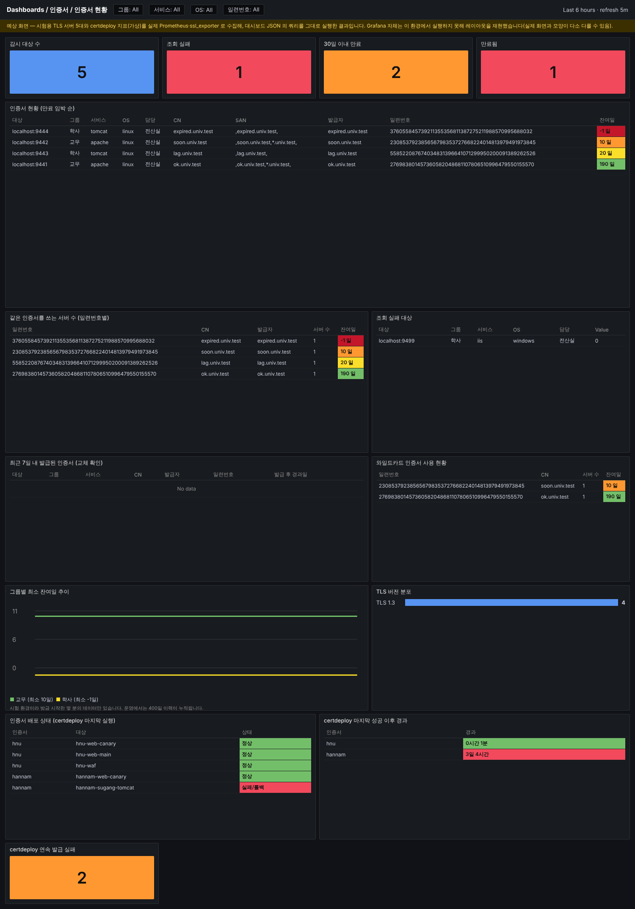
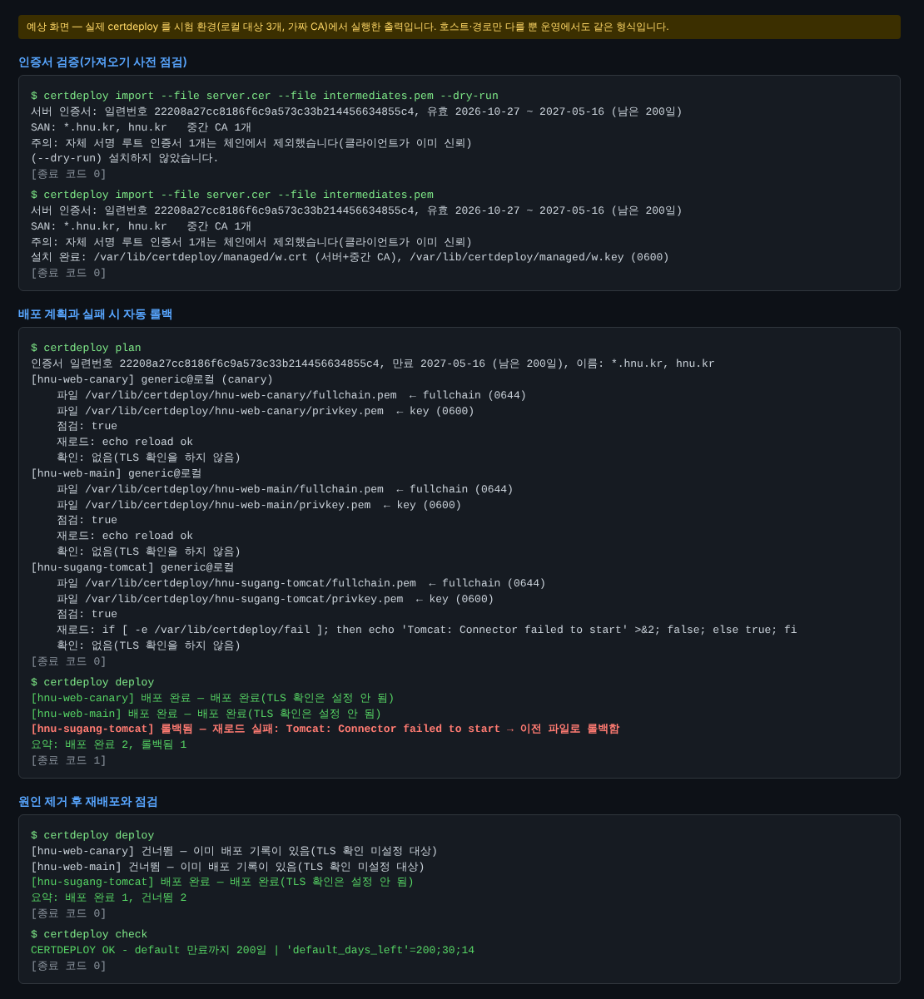
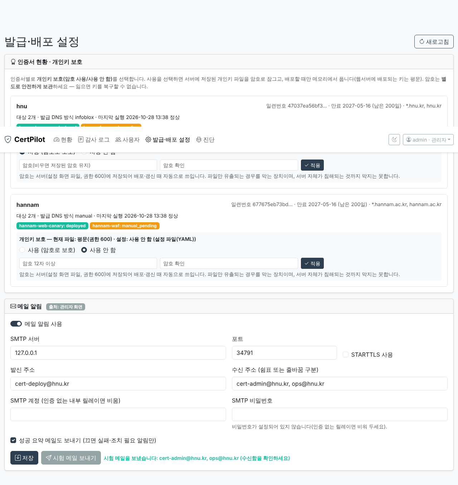

# 관리 서버 설치·테스트 매뉴얼 (Rocky Linux 10.x, 명령어 상세)

**관리 서버 1대**(Rocky Linux 10.x)에 *감시 스택*(Prometheus·ssl_exporter·Alertmanager·Grafana·Pushgateway)과 *발급·배포 도구*(`certdeploy`)를 함께 구성한다. 인증서는 **도메인별로 나눠**(`hnu`, `hannam`) 관리하고, 발급은 상용 CA 와일드카드를 **수동으로 추가**(`csr`→`import`)하거나 Let's Encrypt **자동 발급**(7-3, DNS 연동/수동 TXT) 중에서 고르며, 배포는 자동화한다. 메일 알림과 인증서별 개인키 보호(암호 사용/사용 안 함)는 **관리자 화면**(7-5)에서 입력·선택한다.
각 명령은 위에서 아래로 순서대로 실행한다. 시험 절차는 [테스트 시나리오](test-scenarios.md), 문제 수집은 [디버깅 가이드](debugging.md).

> ⚠️ **현재 RapidSSL 와일드카드는 2026-11-12 08:59(KST) 만료**다. 이 시스템의 시험 완료를 기다리지 말고, 만료 전 교체는 기존 절차([교체 체크리스트](cert-rotation-checklist.md))로 진행한다. 교체본으로 8~9단계를 처음 실사용해도 된다(실패하면 자동 롤백).
> 이 문서의 OS 명령은 RHEL 계열 표준 절차이며 Rocky 10 에서 직접 실행해 보지는 못했다. 막히면 **그 단계의 명령과 출력**을 알려 달라.

> 📋 설치 전에 정할 것·모을 정보·요청 문구는 **[VM 구성 전 준비 체크리스트](pre-vm-checklist.md)**, 검증 현황은 [검증 보고서](verification-report.md).

## 자동 설치 (Rocky 설치 후 2~9단계를 한 번에) — 선택
Rocky Linux 10 을 설치하고(1단계) 네트워크가 되면, **2~7-5단계의 대부분을 스크립트 한 번으로** 진행할 수 있다. 수동 단계로 하고 싶으면 이 절을 건너뛰고 아래 2단계부터 따라 한다.

| 방법 | 언제 | 비고 |
|---|---|---|
| **A. 설치 스크립트 `scripts/install-mgmt-server.sh` (권장)** | OS 설치 후 한 번 실행 | 단계별 재실행 가능, 비밀번호 자동 생성, `--dry-run` 지원 |
| B. Kickstart `scripts/kickstart/rocky10-mgmt.ks.example` | OS 설치까지 무인화(VM 여러 대·재구축) | `ksvalidator -v RHEL10` 문법 검증됨. 설치 후 A 를 이어 실행 |
| C. VMware 템플릿/스냅샷 | 장애 복구·동일 구성 복제 | A 완료 직후 스냅샷을 떠 두면 재설치 불필요 |
| D. Ansible | 관리 서버가 여러 대로 늘 때 | 지금은 과함(1대 구성) — 필요해지면 스크립트의 단계를 그대로 옮기면 됨 |

```bash
sudo dnf -y install git && sudo git clone https://github.com/dongjincho508/certpilot.git /opt/cert-monitor/src
cd /opt/cert-monitor/src
sudo bash scripts/install-mgmt-server.sh --dry-run --yes --hostname mgmt.hnu.kr --mail-to cert-admin@hnu.kr --smtp-host smtp.hnu.kr:587 --smtp-from cert-monitor@hnu.kr
```
먼저 `--dry-run` 으로 할 일만 확인한 뒤, 같은 명령에서 `--dry-run` 을 빼고 실행한다. SMTP 계정이 필요하면 `--smtp-user ID` 를 주고 비밀번호는 **환경변수로** 전달한다(`sudo SMTP_PASSWORD='...' bash scripts/...`; 명령 이력에 남지 않게 입력 후 `history -d` 또는 설치 후 `alertmanager/secrets/smtp_password` 에 직접 입력). 관리자 PC 대역만 8443 을 허용하려면 `--admin-cidr 10.10.0.0/24`.

- 실행 내용: 사전 점검(OS·SELinux·CPU·외부 접속) → 기본 설정/패키지 → Docker → 소스 → 감시 스택(설정 검증 후 기동) → nginx(임시 자체 서명 인증서)+방화벽 → certdeploy → 관리자 화면 → 점검.
- 끝나면 화면과 `/root/cert-install-summary.txt`(권한 600)에 접속 주소·**자동 생성된 Grafana/관리자 비밀번호**·배포용 SSH 공개키·남은 수동 작업이 나온다. 확인 후 안전한 곳에 옮기고 파일을 삭제한다.
- 실패하면 원인을 고치고 **같은 명령을 다시** 실행한다(끝난 단계는 건너뜀, 강제로 다시 하려면 `--force`, 일부만 하려면 `--only monitoring,nginx`). 로그는 `/var/log/cert-install.log`.
- 스크립트가 하지 **않는** 일(수동): 감시 대상 서버 목록, `certdeploy.yml` 의 실제 대상·경로, 대상 서버 준비(8단계), 인증서 발급·반입(9단계), 정식 HTTPS 인증서 교체, 메일 시험.
- 한계: 이 스크립트는 문법·`shellcheck`·`--dry-run`(무변경)·설정 생성(Alertmanager `amtool` 검증)까지만 시험했고 **실제 Rocky 10 에서는 아직 실행해 보지 못했다**. 막히면 출력과 로그를 알려 달라.

## 구성
```
 관리자 PC ──HTTPS 443/8443──▶ [관리 서버 Rocky 10]
                           ├ nginx(443) ─▶ Grafana(127.0.0.1:3000)
                           ├ nginx(8443) ─▶ 관리자 화면(127.0.0.1:8081: 메일·개인키 보호 설정, 계정 certdeploy)
                           ├ Docker: Prometheus(9090) · Alertmanager(9093) · Pushgateway(9091) · ssl_exporter · Grafana  (모두 127.0.0.1 바인딩)
                           └ certdeploy(계정 certdeploy, 개인키 보관) ──SSH 22──▶ 대상 서버들(deploy 계정)
 감시: 관리 서버 ──TLS 접속──▶ 대상 서버들의 443/8443 …
```
개인키는 관리 서버의 `certdeploy` 계정만 접근한다. 관리자 계정(`certadmin`)은 개인키를 읽을 수 없게 둔다(권한 700/600).

## 예상 화면 (설치 후 이렇게 보인다)
> 아래는 **시험 환경에서 만든 예상 화면**이다. 관리 서버에서 보는 화면은 **① Grafana 대시보드 ② 터미널 `certdeploy` 출력 ③ 알림(메일) ④ 관리자 화면(발급·배포 설정)** 이다. (Render 에 올린 CertPilot 앱은 사용하지 않는다 — ④ 는 같은 코드를 관리 서버에 설치한 설정 화면이다.)

**① Grafana 「인증서 현황」** — 시험용 TLS 서버 5대와 가상 certdeploy 지표를 *실제* Prometheus·ssl_exporter 로 수집해 대시보드 JSON 의 쿼리를 그대로 실행한 결과(Grafana 자체는 이 환경에서 실행하지 못해 레이아웃을 재현했으므로 실제 모양과 다소 다를 수 있음). 상단 카드(감시 대상·조회 실패·30일 이내 만료·만료됨), 만료 임박 순 표, 같은 인증서를 쓰는 서버 수, 와일드카드 사용 현황, certdeploy 배포 상태·마지막 성공 이후 경과·연속 발급 실패.


**② 터미널 `certdeploy`** — 실제 certdeploy 를 시험 환경(로컬 대상 3개, 가짜 CA)에서 실행한 출력. 세 번째 대상의 재로드 실패 → 자동 롤백 → 원인 제거 후 재배포(이미 배포된 대상은 건너뜀) → `check`.


**③ 알림** — 배포 실패·DNS TXT 등록 필요·수동 교체 필요·만료 임박 알림이 메일(우선)로 전달되고, 해소되면 복구 알림이 온다(T-02, T-19 에서 확인).

**④ 관리자 화면 「발급·배포 설정」** — 인증서(도메인)별 현황(일련번호·만료·대상별 마지막 실행)과 **개인키 보호 사용/사용 안 함 선택**(적용하면 키 파일이 바로 변환됨), **메일 알림 입력·저장·시험 메일**. 아래는 시험 서버(가짜 SMTP)에서 실제로 동작시킨 화면이다.


## 0. 준비물 (설치 전)
- [ ] VM: 4 vCPU / 8 GB / 디스크 100 GB 이상(`/var` 40 GB 이상). **CPU 는 x86-64-v3 지원**(VM 설정에서 호스트 CPU 통과) — 아니면 Rocky 10 이 설치·부팅되지 않는다
- [ ] 고정 IP, 호스트명(예: `mgmt.univ.example`), 내부 DNS 등록
- [ ] 방화벽 요청(관리 서버 기준) — 나가는: 대상 서버 TLS 포트(443, 8443 …)와 SSH 22, SMTP 25/587, NTP, DNS, (설치 중) `download.docker.com`·`registry-1.docker.io`·`github.com`·Rocky 미러 / 들어오는: 관리자 PC → 22, 443, **8443(관리자 화면)**
- [ ] 대상 서버 목록(호스트·포트·OS·웹서버 종류), 각 서버에 `deploy` 계정을 만들 수 있는지
- [ ] SMTP 릴레이(주소·포트·인증), 알림 수신 주소, (선택) Teams 웹훅 URL
- [ ] 상용 인증서 주문 계정(RapidSSL 등) 접근 권한
- 인터넷이 막혀 있으면: 교내 프록시 주소(2·3단계에 설정 위치 표시), 또는 이미지 반입([rocky-linux-deploy.md](rocky-linux-deploy.md) 5-5)

### 0-1. VMware(vSphere/ESXi) VM 생성 설정
VM 을 **만들기 전에** 아래를 정한다(생성 후 바꾸기 어렵거나 설치가 막히는 항목 위주). 메뉴 이름은 vSphere 버전에 따라 다를 수 있다.
| 항목 | 설정 | 이유 |
|---|---|---|
| CPU 호환성 | **EVC 모드/CPU 호환성 마스크가 구형이면 해제하거나 x86-64-v3(AVX2) 이상을 노출하는 모드**로. 클러스터 EVC 가 구형 기준이면 담당자와 협의 | Rocky 10 은 x86-64-v3 CPU 를 요구한다. 구형 호환 모드에서는 설치 미디어가 부팅되지 않는다 |
| 호환성(가상 하드웨어 버전) | 호스트가 지원하는 **최신 버전** | 최신 CPU 기능·드라이버 |
| 게스트 OS 종류 | 목록에 Rocky Linux/RHEL 10 이 있으면 그것, 없으면 *Other Linux (64-bit)* 계열 중 가장 최신 | 드라이버·튜닝 선택용(동작에는 영향 적음) |
| 펌웨어 | UEFI(Secure Boot 사용 가능) | Rocky 는 Secure Boot 서명 지원 |
| 디스크 | 한 개 100 GB 이상, **씬 프로비저닝 가능**(데이터스토어 여유 확인), SCSI 컨트롤러 *VMware Paravirtual* | `/var` 에 Docker 이미지·Prometheus 이력이 쌓임 |
| 네트워크 | 어댑터 *VMXNET3*, 대상 서버와 통신 가능한 포트 그룹, 고정 IP | 관리 서버 → 대상 서버(443/22) 도달성 |
| 시간 | **VMware Tools 의 주기적 시간 동기화는 끄고** 게스트의 chrony 로 동기화(2단계) | 만료 계산·알림이 시각에 의존. 이중 동기화는 시각을 흔든다 |
| CD/DVD | Rocky 10 ISO(Minimal) 연결 후 설치가 끝나면 분리 | |
| 리소스 예약 | 메모리 예약 8 GB(가능하면) | 감시 컨테이너가 스왑으로 밀리지 않게 |
| 스냅샷 | 평소에는 **스냅샷 없음**, 작업 전에만 생성 후 확인되면 삭제(10단계 정책) | 스냅샷에는 개인키가 들어 있고 오래 두면 성능·용량 문제 |
| 위치 | 일반 업무 VM 과 **접근 권한이 분리된 폴더/리소스 풀**, VM 콘솔·스냅샷·내보내기 권한을 최소 인원에게만 | 개인키가 VM 디스크에 있으므로 vSphere 권한이 곧 키 접근 권한 |

## 1. Rocky Linux 10 설치
1. Rocky 10 ISO(Minimal) 부팅 → 시간대 `Asia/Seoul`, 소프트웨어 선택 **최소 설치**
2. 파티션(LVM): `/` 30 GB 이상, **`/var` 40 GB 이상**(Docker 이미지·Prometheus 이력)
3. 고정 IP·게이트웨이·교내 DNS·호스트명 설정
4. **디스크 암호화(LUKS) 결정** — 설치 화면의 *Installation Destination → Encrypt my data* 를 선택하면 디스크 전체가 암호화된다. 설치 중에만 선택할 수 있다.
   - 장점: VM 디스크(VMDK)·스냅샷·백업 이미지를 반출/유출해도 개인키를 읽을 수 없다
   - 단점(운영에 영향): **재부팅마다 암호를 콘솔에 직접 입력**해야 부팅된다(무인 재부팅 불가, 정전·호스트 장애 후 사람이 필요). 암호 분실 = 복구 불가 → 암호는 2인 이상이 봉인 보관
   - 대안: vSphere VM Encryption/데이터스토어 암호화(KMS 필요)를 전산실이 제공하면 게스트 LUKS 없이 같은 효과를 얻을 수 있다. 어느 쪽도 못 쓰면 10단계의 VM 백업·스냅샷 접근 통제로 보완
5. root SSH 비밀번호 로그인은 쓰지 않고, **일반 관리자 계정(wheel)** 을 만든 뒤 재부팅 → 그 계정으로 SSH 접속

## 2. 초기 설정
```bash
sudo dnf -y update
```
```bash
sudo hostnamectl set-hostname mgmt.univ.example
```
```bash
sudo timedatectl set-timezone Asia/Seoul
```
**VMware 게스트 도구**(VMware 위에서만)
```bash
sudo dnf -y install open-vm-tools && sudo systemctl enable --now vmtoolsd
```
```bash
vmware-toolbox-cmd timesync disable && vmware-toolbox-cmd timesync status
```
(`Disabled` 여야 한다. VMware 의 시간 동기화는 끄고 아래 chrony 만 쓴다.)
**시각 동기화(필수)** — 만료 계산·알림이 서버 시각에 의존한다. 교내 NTP 가 있으면 `/etc/chrony.conf` 의 `pool` 줄을 교내 NTP 로 바꾼다.
```bash
sudo systemctl enable --now chronyd
```
```bash
chronyc tracking
```
(`System time` 오차 1초 이내)
**SELinux 는 enforcing 유지**(끄지 않는다), 방화벽은 기본 활성:
```bash
getenforce
```
```bash
sudo firewall-cmd --state && sudo firewall-cmd --list-all
```
**관리자 계정 SSH 키 등록**(PC 에서 `ssh-keygen -t ed25519` 로 만든 공개키):
```bash
sudo useradd -m -G wheel certadmin && sudo passwd certadmin
```
```bash
sudo -u certadmin mkdir -p -m 700 /home/certadmin/.ssh && echo '<PC 공개키 한 줄>' | sudo -u certadmin tee -a /home/certadmin/.ssh/authorized_keys >/dev/null && sudo chmod 600 /home/certadmin/.ssh/authorized_keys && sudo restorecon -R /home/certadmin/.ssh
```
**새 터미널에서 키로 접속되는지 확인한 뒤** 비밀번호 로그인을 끈다:
```bash
printf 'PermitRootLogin no\nPasswordAuthentication no\n' | sudo tee /etc/ssh/sshd_config.d/10-hardening.conf && sudo sshd -t && sudo systemctl reload sshd
```
보안 업데이트 자동화(선택):
```bash
sudo dnf -y install dnf-automatic && sudo systemctl enable --now dnf-automatic-install.timer
```
교내 프록시가 필요하면 `/etc/dnf/dnf.conf` 의 `[main]` 에 `proxy=http://프록시:포트` 를 추가한다.

## 3. Docker 설치 (Docker 공식 저장소)
Docker 저장소에 CentOS/RHEL **10** 경로가 있음을 확인했다. Rocky 는 CentOS 용 저장소 파일을 쓴다.
```bash
sudo dnf -y install dnf-plugins-core && sudo dnf config-manager --add-repo https://download.docker.com/linux/centos/docker-ce.repo
```
```bash
sudo dnf -y install docker-ce docker-ce-cli containerd.io docker-buildx-plugin docker-compose-plugin && sudo systemctl enable --now docker
```
```bash
sudo docker run --rm hello-world && docker compose version
```
로그 용량 제한(디스크 보호):
```bash
printf '{ "log-driver": "json-file", "log-opts": { "max-size": "20m", "max-file": "5" } }\n' | sudo tee /etc/docker/daemon.json && sudo systemctl restart docker
```
프록시가 필요하면 `/etc/systemd/system/docker.service.d/proxy.conf` 에 `[Service]`, `Environment="HTTPS_PROXY=http://프록시:포트"`, `Environment="NO_PROXY=localhost,127.0.0.1"` 를 쓰고 `sudo systemctl daemon-reload && sudo systemctl restart docker`.
`docker` 그룹은 root 와 동급이므로 필요한 관리자에게만: `sudo usermod -aG docker certadmin` 후 재로그인.

## 4. 소스 배치
```bash
sudo dnf -y install git python3 python3-pip python3-pyyaml openssl bind-utils
```
```bash
sudo mkdir -p /opt/cert-monitor && sudo chown certadmin: /opt/cert-monitor && git clone https://github.com/dongjincho508/certpilot.git /opt/cert-monitor/src
```
(GitHub 접속이 막혀 있으면 PC 에서 압축해 `scp` 로 올려 `/opt/cert-monitor/src` 에 푼다. 이후 갱신은 `git pull`.)

## 5. 감시 스택 설정·기동
```bash
cd /opt/cert-monitor/src/monitoring && cp .env.example .env && chmod 600 .env
```
`.env` 편집(`vi .env`): `GRAFANA_ADMIN_PASSWORD`(12자 이상, **필수** — 비어 있으면 기동 거부), `GRAFANA_ROOT_URL=https://mgmt.univ.example`. `GRAFANA_BIND`·`PUSHGATEWAY_BIND` 는 `127.0.0.1` 그대로(같은 서버의 certdeploy 가 쓰고, 외부는 nginx 가 담당).

**알림 비밀 값**
```bash
cp -r alertmanager/secrets.example alertmanager/secrets && chmod 700 alertmanager/secrets && chmod 600 alertmanager/secrets/* && sudo chown -R 65534:65534 alertmanager/secrets
```
(Alertmanager 컨테이너는 `nobody`(uid 65534)로 실행되므로 소유자를 맞춰야 읽을 수 있다 — 위 `chown`. 이후 이 파일을 고칠 때는 `sudo -e` 로 편집.)
- `alertmanager/secrets/smtp_password`: SMTP 비밀번호 한 줄(인증 없는 릴레이면 `alertmanager.yml` 의 `smtp_auth_username`/`smtp_auth_password_file` 삭제)
- `alertmanager/secrets/webhook_url`: Teams 웹훅 URL 한 줄(미사용이면 `alertmanager.yml` 의 `ops-critical` 에서 `webhook_configs` 삭제)
- `alertmanager/alertmanager.yml` 의 `TODO` 3곳: `smtp_smarthost`, `smtp_from`, 수신자 `to`

**감시 대상 등록**(처음엔 3~5대로 시작)
```bash
cp prometheus/targets/servers.yml.example prometheus/targets/servers.yml
```
`servers.yml` 을 실제 서버로 수정하거나 CSV 로 생성: `host,port,group,service,os,owner` 열
```bash
python3 scripts/csv_to_targets.py /home/certadmin/servers.csv -o prometheus/targets/servers.yml
```
**기동 전 설정 검증**(공식 이미지의 도구 — 모두 `SUCCESS`)
```bash
docker run --rm -v "$PWD/prometheus:/etc/prometheus:ro,z" --entrypoint promtool prom/prometheus:v3.5.0 check config /etc/prometheus/prometheus.yml
```
```bash
docker run --rm -v "$PWD/prometheus:/etc/prometheus:ro,z" --entrypoint promtool prom/prometheus:v3.5.0 test rules /etc/prometheus/tests/cert-expiry.test.yml
```
```bash
docker run --rm -v "$PWD/alertmanager:/etc/alertmanager:ro,z" --entrypoint amtool prom/alertmanager:v0.28.1 check-config /etc/alertmanager/alertmanager.yml
```
**기동·확인**
```bash
docker compose config -q && docker compose up -d && docker compose ps
```
5개 서비스(`ssl-exporter`, `prometheus`, `pushgateway`, `alertmanager`, `grafana`)가 `running` 이어야 한다. 이상하면 `docker compose logs --tail=100 <서비스>`.
```bash
curl -s http://127.0.0.1:9090/-/ready && curl -s http://127.0.0.1:9093/-/ready && curl -s http://127.0.0.1:9091/-/ready
```
```bash
python3 scripts/cert_inventory.py list
```
**알림 경로 시험**(수 분 내 메일 수신)
```bash
docker compose exec alertmanager amtool --alertmanager.url=http://localhost:9093 alert add TestAlert severity=warning instance=test:443 -a summary="테스트 알림" -a description="메일 경로 시험"
```

## 6. HTTPS 역프록시 (nginx) — 교내 접속용
Docker 로 게시한 포트는 firewalld 를 우회할 수 있으므로 Grafana 는 `127.0.0.1` 로만 열고 호스트 nginx 가 HTTPS 를 제공한다.
```bash
sudo dnf -y install nginx && sudo cp /opt/cert-monitor/src/monitoring/nginx/grafana.conf.example /etc/nginx/conf.d/grafana.conf
```
`/etc/nginx/conf.d/grafana.conf` 의 `TODO`(서버명, 인증서 경로) 수정. 처음에는 임시 자체 서명 인증서로 시작하고 8~9단계 이후 정식 인증서로 교체한다:
```bash
sudo openssl req -x509 -newkey rsa:2048 -nodes -keyout /etc/pki/tls/private/mgmt.key -out /etc/pki/tls/certs/mgmt.crt -days 365 -subj "/CN=mgmt.univ.example" && sudo chmod 600 /etc/pki/tls/private/mgmt.key
```
```bash
sudo setsebool -P httpd_can_network_connect on && sudo nginx -t && sudo systemctl enable --now nginx
```
```bash
sudo firewall-cmd --permanent --add-service=https && sudo firewall-cmd --reload
```
브라우저로 `https://mgmt.univ.example` → Grafana 로그인 → 「인증서 현황」 대시보드 확인. 이 관리 서버 자신의 HTTPS 주소도 `servers.yml` 에 넣어 만료를 감시한다.

## 7. certdeploy 설치 (같은 서버)
### 7-1. 계정·디렉터리·설치
```bash
sudo useradd --system --create-home --home-dir /var/lib/certdeploy --shell /sbin/nologin certdeploy
```
```bash
sudo install -d -m 700 -o certdeploy -g certdeploy /var/lib/certdeploy/.ssh /var/lib/certdeploy/managed && sudo install -d -m 750 -o root -g certdeploy /etc/certdeploy
```
```bash
sudo python3 -m venv /opt/certdeploy/venv && sudo /opt/certdeploy/venv/bin/pip install /opt/cert-monitor/src
```
```bash
sudo -u certdeploy /opt/certdeploy/venv/bin/certdeploy -c /etc/certdeploy/certdeploy.yml --version
```
JKS(Tomcat/JEUS)가 필요하면: `sudo dnf -y install java-17-openjdk-headless` (keytool).

### 7-2. 설정 파일(수동 인증서 + 자동 배포)
```bash
sudo cp /opt/cert-monitor/src/certdeploy/certdeploy.manual.example.yml /etc/certdeploy/certdeploy.yml && sudo chgrp certdeploy /etc/certdeploy/certdeploy.yml && sudo chmod 640 /etc/certdeploy/certdeploy.yml && sudoedit /etc/certdeploy/certdeploy.yml
```
대상(`targets`)의 호스트·경로·재로드 명령을 실제 값으로 수정한다(처음에는 시험용 1대만). 키스토어 비밀번호는 환경변수 파일에:
```bash
echo 'TOMCAT_KS_PASS=<비밀번호>' | sudo tee /etc/certdeploy/env >/dev/null && sudo chown certdeploy:certdeploy /etc/certdeploy/env && sudo chmod 600 /etc/certdeploy/env
```
**알림은 메일 우선 — 입력은 관리자 화면에서**: SMTP 서버·수신자·계정·비밀번호는 **7-5 의 관리자 화면 > 발급·배포 설정 > 메일 알림**에서 입력·저장하고 [시험 메일 보내기]로 확인한다(화면 값이 설정 파일보다 우선하며 `/var/lib/certdeploy/settings.json` 에 권한 600 으로 저장됨). 화면 없이 쓰려면 설정의 `notify.smtp` 와 `/etc/certdeploy/env` 의 `SMTP_PASSWORD` 를 쓴다. Alertmanager(감시 알림)의 메일 설정은 5단계. CLI 로도 시험할 수 있다(아래 `$CD` 정의 뒤):
```bash
$CD notify-test
```
**개인키 저장 방식(선택, 인증서별)**: 기본은 평문(권한 600). **관리자 화면의 「개인키 보호」에서 인증서마다 사용/사용 안 함을 고르고 [적용]**하면 키 파일이 바로 변환된다(평문 사본은 검증 후 삭제). 화면 없이 쓰려면 설정에 `key_encryption: passphrase`, `key_password_env` 를 켜고 `$CD --cert hnu key-encrypt`(설명·장단점: [준비 체크리스트 D9](pre-vm-checklist.md), 시험 T-20·T-22). 어느 쪽이든 대상 서버에 배포되는 키는 평문이다.

편의 변수(이후 명령에서 사용 — 새 터미널마다 다시 지정):
```bash
CD="sudo -u certdeploy /opt/certdeploy/venv/bin/certdeploy -c /etc/certdeploy/certdeploy.yml"
```

### 7-3. (선택) 자동 발급 — **내장 ACME(권장, lego 불필요)** 또는 lego
내장 ACME(Let's Encrypt, DNS-01)는 [자동 발급 가이드](auto-issue.md)를 따른다(설정 예시 `certdeploy/certdeploy.acme.example.yml`, Infoblox 연동 또는 수동 TXT 방식). 아래는 lego 를 대신 쓰고 싶을 때만 필요하다.

#### lego 설치(대체 방식)
```bash
LEGO_VER=X.Y.Z   # https://github.com/go-acme/lego/releases 에서 확인한 최신 버전 번호로 바꾼다
```
```bash
cd /tmp && curl -fLO https://github.com/go-acme/lego/releases/download/v${LEGO_VER}/lego_v${LEGO_VER}_linux_amd64.tar.gz && curl -fLO https://github.com/go-acme/lego/releases/download/v${LEGO_VER}/lego_v${LEGO_VER}_checksums.txt
```
```bash
sha256sum -c --ignore-missing lego_v${LEGO_VER}_checksums.txt && sudo tar -xzf lego_v${LEGO_VER}_linux_amd64.tar.gz -C /usr/local/bin lego && lego --version
```
```bash
lego dnshelp -c infoblox
```
출력된 환경변수 이름을 `/etc/lego/lego.env`(권한 600)에 쓰고 설정 파일에 `lego:` 블록을 추가한다([certdeploy.md](certdeploy.md), [acme-automation.md](acme-automation.md)). 이 경로는 반드시 `issue --staging --no-deploy` 로 먼저 시험한다.

### 7-4. 배포용 SSH 키 생성
```bash
sudo -u certdeploy ssh-keygen -t ed25519 -N "" -f /var/lib/certdeploy/.ssh/id_ed25519 && sudo cat /var/lib/certdeploy/.ssh/id_ed25519.pub
```
출력된 **공개키**를 8단계에서 각 대상 서버의 `deploy` 계정에 등록한다. 호스트 키는 **미리 등록**(certdeploy 는 known_hosts 에 없거나 바뀐 서버를 거부한다). 지문은 서버 관리자와 대조한다.
```bash
sudo -u certdeploy sh -c 'ssh-keyscan -t ed25519 www1.univ.example >> /var/lib/certdeploy/.ssh/known_hosts'
```
```bash
sudo -u certdeploy ssh-keygen -lf /var/lib/certdeploy/.ssh/known_hosts
```

### 7-5. 관리자 화면(발급·배포 설정) 설치
메일 입력과 인증서별 개인키 보호 선택을 웹 화면에서 하기 위한 설정 화면이다(CertPilot 웹 코드를 관리 서버에 설치 — Render 의 것과 별개). **7-4 까지 끝난 뒤** 진행한다. 로그인·권한(관리자)·감사 로그는 CertPilot 기능을 그대로 쓰고, 화면은 `certdeploy` 설정 파일 위치(`CERTDEPLOY_CONFIG`)를 통해 같은 서버의 인증서·상태를 읽는다.
```bash
sudo install -d -m 700 -o certdeploy -g certdeploy /var/lib/certdeploy-admin
```
환경변수 파일(최초 관리자 계정은 **12자 이상 강한 비밀번호**, 첫 기동 때만 사용되며 이후 화면에서 변경):
```bash
sudo install -m 600 -o certdeploy -g certdeploy /dev/null /etc/certdeploy/admin.env && sudoedit /etc/certdeploy/admin.env
```
파일 내용(값은 실제로 채운다):
```
CERTPILOT_ADMIN_USER=certadmin2
CERTPILOT_ADMIN_PASSWORD=<12자 이상 강한 비밀번호>
CERTDEPLOY_CONFIG=/etc/certdeploy/certdeploy.yml
CERTPILOT_DATA_DIR=/var/lib/certdeploy-admin
CERTPILOT_SECURE_COOKIE=1
```
서비스 설치·기동:
```bash
sudo cp /opt/cert-monitor/src/certdeploy/systemd/certdeploy-admin.service /etc/systemd/system/ && sudo systemctl daemon-reload && sudo systemctl enable --now certdeploy-admin
```
```bash
systemctl is-active certdeploy-admin && curl -s http://127.0.0.1:8081/health
```
HTTPS 역프록시(8443):
```bash
sudo cp /opt/cert-monitor/src/monitoring/nginx/certdeploy-admin.conf.example /etc/nginx/conf.d/certdeploy-admin.conf && sudoedit /etc/nginx/conf.d/certdeploy-admin.conf
```
```bash
sudo nginx -t && sudo systemctl reload nginx && sudo firewall-cmd --permanent --add-port=8443/tcp && sudo firewall-cmd --reload
```
브라우저로 `https://mgmt.univ.example:8443` → 위 관리자 계정으로 로그인 → 상단 **「발급·배포 설정」**:
1. **메일 알림**: SMTP 서버·포트·STARTTLS·발신/수신 주소(쉼표 구분)·계정·비밀번호 입력 → [시험 메일 보내기]로 도착 확인 → [저장]. 실패하면 원인(연결 거부·로그인 실패·TLS 오류 등)이 화면에 표시된다
2. **개인키 보호**: 인증서(`hnu`, `hannam`)마다 「사용(암호로 보호)」/「사용 안 함」 선택 → 사용이면 암호(12자 이상) 입력 → [적용]. **암호는 별도로 안전하게 보관**(2인 이상, 봉인) — 잃으면 키를 복구할 수 없다
3. 화면 값은 `/var/lib/certdeploy/settings.json`(0600)에 저장되어 `certdeploy` CLI·타이머가 자동 적용한다. 확인: `$CD validate`(출력에 "관리자 화면(settings.json) 적용" 표시)
> **보안**: 8443 은 관리자 PC 대역만 방화벽에서 허용한다. 서버에 저장되는 SMTP 비밀번호·개인키 암호는 `settings.json`(권한 600, certdeploy 계정 전용)에 있으므로, 서버 접근 권한과 백업 보관을 개인키와 같은 수준으로 관리한다. 화면 응답·감사 로그·진단 번들에는 비밀번호·암호가 나오지 않는다.

## 8. 대상 서버 준비 (서버마다, 대상 서버에서 실행)
`deploy` 계정은 **인증서 전용 디렉터리만 쓰고, 재로드 명령만 sudo** 로 실행한다(전체 root 권한 `sudo: true` 는 비권장).
**Apache / Nginx (Rocky 계열 대상)**
```bash
sudo useradd -m -s /bin/bash deploy && sudo -u deploy mkdir -p -m 700 /home/deploy/.ssh && echo '<7-4 에서 출력한 공개키>' | sudo -u deploy tee -a /home/deploy/.ssh/authorized_keys >/dev/null && sudo chmod 600 /home/deploy/.ssh/authorized_keys && sudo restorecon -R /home/deploy/.ssh
```
```bash
sudo install -d -m 750 -o deploy -g apache /etc/ssl/univ
```
```bash
echo 'deploy ALL=(root) NOPASSWD: /usr/bin/systemctl reload httpd, /usr/sbin/apachectl configtest' | sudo tee /etc/sudoers.d/certdeploy && sudo chmod 440 /etc/sudoers.d/certdeploy && sudo visudo -c
```
```bash
sudo dnf -y install policycoreutils-python-utils && sudo semanage fcontext -a -t cert_t '/etc/ssl/univ(/.*)?' && sudo restorecon -Rv /etc/ssl/univ
```
Apache 설정은 먼저 **수동으로** `SSLCertificateFile /etc/ssl/univ/fullchain.pem`, `SSLCertificateKeyFile /etc/ssl/univ/privkey.pem` 을 가리키게 바꾸고(처음 한 번 현재 인증서를 그 경로에 복사) `apachectl configtest` 통과를 확인한다.
**Ubuntu/Debian 대상**: 서비스 이름이 `apache2` 이므로 sudoers·`reload_cmd` 의 `httpd` 를 `apache2` 로 바꾼다.
**Tomcat / WebtoB·JEUS / Node.js**: 키스토어 경로·형식·재로드(재기동) 명령은 **제품 문서와 현재 설정으로 확인**해 `targets` 에 반영한다(`reload_cmd` 는 sudoers 에 해당 명령만 허용).
**웹방화벽(모니터랩)**: API/CLI 가 확인되기 전에는 **옵션 C(사람이 교체)** 로 시작한다 — 설정은 `certdeploy.waf-manual.example.yml`, 시험은 T-21. API 문서가 오면 옵션 A(`http_api`, T-18)로 전환. 선택 가이드·확인 질문은 [호환성 가이드](compatibility.md).
**IIS(Windows)**: 관리 서버에서 만든 PFX 를 옮겨 [deploy-iis.ps1](../../certdeploy/deploy-iis.ps1)(초안·미검증)로 바인딩을 교체한다. 자동화는 SSH 가 가능한 구성이 필요하므로 별도 협의.

## 9. 인증서 준비(수동)와 첫 배포
```bash
$CD validate
```
```bash
$CD preflight
```
`preflight` 는 접속·쓰기 권한·명령·sudo·여유 공간·현재 TLS 를 **변경 없이** 점검한다. 전부 통과해야 한다.
**CSR 생성 → CA 제출**
```bash
$CD --cert hnu csr --domains '*.hnu.kr,hnu.kr' --country KR --org '대학명'
```
출력된 CSR 을 RapidSSL 주문 화면에 붙여 넣는다(개인키는 `/var/lib/certdeploy/pending/…/key.pem`, 0600 — 외부로 보내지 않는다).
**CA 가 준 파일 검증·설치**(`/tmp` 에 올린 뒤)
```bash
$CD --cert hnu import --file /tmp/server.cer --file /tmp/intermediates.p7b --dry-run
```
이상 없으면 설치만, 또는 설치+배포:
```bash
$CD --cert hnu import --file /tmp/server.cer --file /tmp/intermediates.p7b
```
```bash
$CD --cert hnu plan
```
```bash
$CD --cert hnu deploy --target hnu-web-canary
```
```bash
$CD check
```
서빙 확인(외부 독립 확인): `echo | openssl s_client -connect www1.univ.example:443 -servername www1.univ.example 2>/dev/null | openssl x509 -noout -serial -enddate -subject`
canary 확인 후 나머지 대상을 `targets` 에 추가하고 `$CD --cert hnu preflight` → `$CD --cert hnu deploy`. **인증서가 도메인별로 나뉘어 있으므로 `--cert hnu` / `--cert hannam` 으로 하나씩** 진행한다(`hannam` 도 같은 순서). 지표 연동 점검:
```bash
$CD diagnose --prometheus http://127.0.0.1:9090 --alertmanager http://127.0.0.1:9093 --pushgateway http://127.0.0.1:9091
```
임시 파일 정리: `sudo shred -u /tmp/server.cer /tmp/intermediates.p7b`(인증서라 비밀은 아니지만 정리 습관).

## 10. 운영 설정
**재부팅 후 자동 기동 확인**: Docker 는 `enable` 했고 컨테이너는 `restart: unless-stopped`.
```bash
sudo reboot
```
재접속 후:
```bash
docker compose -f /opt/cert-monitor/src/monitoring/docker-compose.yml ps && systemctl is-active docker nginx chronyd firewalld
```
**VM 스냅샷·VM 백업 정책(VMware)**
- 스냅샷은 **작업 직전에만** 만들고(OS 업데이트, 감시/certdeploy 업그레이드, 설정 대변경) 정상 확인 후 **당일 삭제**한다. 오래 둔 스냅샷은 디스크 용량·I/O 성능을 해친다. *메모리 포함* 스냅샷은 메모리의 개인키까지 담으므로 필요할 때만 쓴다
- VM 단위 백업 제품(Veeam 등)을 쓰면 **백업 이미지에 개인키가 들어 있다** → 백업 저장소를 암호화하고 접근 인원을 관리 서버 관리자와 같은 수준으로 제한한다
- **복구(스냅샷 되돌리기/백업 복원) 직후 점검**: 시각이 어긋나 있을 수 있고(`sudo chronyc makestep && chronyc tracking`), certdeploy 의 배포 기록이 과거 상태일 수 있다. 다음을 실행해 실제 서빙 상태와 대조한다:
```bash
sudo chronyc makestep && chronyc tracking
```
```bash
$CD status
```
```bash
$CD check
```
  서빙 인증서와 기록이 다르면 `$CD plan` 후 `$CD deploy` 로 맞춘다(이미 같은 인증서면 건너뛴다). Prometheus 이력은 되돌린 시점 이후 구간이 비는 것이 정상이다
- VM 전체 백업과 별개로 아래 **애플리케이션 백업**(암호화)을 유지한다. VM 이 깨져도 이것만 있으면 새 VM 에서 복원된다

**백업**(개인키 포함 → 암호화, 안전한 곳에 보관)
```bash
export BACKUP_PW='<12자 이상 비밀번호>' && $CD backup --out /home/certadmin/certdeploy-$(date +%F).cdbk --passphrase-env BACKUP_PW
```
감시 이력 백업(점검 시간대):
```bash
mkdir -p /opt/cert-monitor/backup && cd /opt/cert-monitor/src/monitoring && docker compose stop prometheus && docker run --rm -v cert-monitor_prometheus-data:/data:ro -v /opt/cert-monitor/backup:/backup:z alpine tar czf /backup/prometheus-$(date +%F).tgz -C /data . && docker compose start prometheus
```
`.env`·`alertmanager/secrets/` 는 암호화한 별도 저장소에 보관(certdeploy 백업에는 관리자 화면 설정 `settings.json` 도 포함됨). **자동 발급(내장 ACME 또는 lego)을 쓸 때** 갱신 타이머를 설치한다(매일 `renew` 실행 — 만료 `renew_days` 이내일 때만 실제 발급·배포):
```bash
sudo cp /opt/cert-monitor/src/certdeploy/systemd/certdeploy-renew.* /etc/systemd/system/ && sudo systemctl daemon-reload && sudo systemctl enable --now certdeploy-renew.timer
```
수동 DNS 방식(`dns.mode: manual`)은 갱신 시점에 타이머가 TXT 안내 메일을 보내고 **종료 코드 4(대기, 오류 아님)** 로 끝나 서비스가 `failed` 로 표시될 수 있다 — TXT 를 등록하면 다음 실행에서 자동으로 이어진다. 상용 인증서를 수동으로 가져오는 방식(`csr`→`import`)만 쓰면 타이머가 필요 없다. 만료 임박은 감시 스택 알림(60/30/14/7일)이 알려 주고, 갱신 때 9단계를 반복한다(유효기간이 단축되므로 장기적으로는 [자동 발급](auto-issue.md)으로 전환).
**업그레이드**: `cd /opt/cert-monitor/src && git pull` → 감시는 `docker compose pull && docker compose up -d`, certdeploy 는 `sudo /opt/certdeploy/venv/bin/pip install --upgrade /opt/cert-monitor/src` 후 관리자 화면 재시작 `sudo systemctl restart certdeploy-admin`.

## 10-1. 인증서 자동 탐색 (미등록 인증서 찾기, 읽기 전용)
등록해 둔 서버만 감시하면 **잊힌 서버·임의로 세운 서버의 인증서**는 만료될 때까지 모른다. `certdeploy-discover` 는 지정한 대역(CIDR)과 호스트명 목록의 TLS 포트(기본 443·8443·9443·8444·993·636)에 접속해 인증서만 읽고, 감시 대상(`targets/*.yml`)에 **없는 것**과 **위험한 것**(만료·30일 이내·자체서명·약한 키/서명·구형 TLS·이름 불일치)을 표시한다. 서버에 아무 것도 설치·변경하지 않는다(접속·핸드셰이크만, 데이터 전송 없음).

> ⚠️ 조사 대역은 **전산실이 관리하는 대역만** 넣는다. 사설 대역이 아니면 `--allow-public` 없이는 거부된다. 포트 스캔은 보안 장비(IDS)에 탐지될 수 있으니 보안 담당에게 시간·대역을 사전 공유한다.

```bash
sudo -u certdeploy /opt/certdeploy/venv/bin/certdeploy-discover --cidr 10.10.0.0/24 --port 443,8443 --emit-targets /var/lib/certdeploy/discovery-new-targets.yml
```
- 결과는 화면과 `/var/lib/certdeploy/discovery.json` 에 남고, 다음 실행 때 **새로 나타남/사라짐/인증서 교체**를 비교해 보여 준다.
- `--emit-targets` 파일은 미등록 인증서를 감시 대상 형식으로 만든 **후보**다. 담당자·서비스 레이블을 확인해 `prometheus/targets/servers.yml` 에 직접 옮긴다(자동 반영은 하지 않음). IP 만 알려진 항목은 호스트명으로 바꿔야 올바른 인증서(SNI)가 조회된다.
- 호스트명 목록(`--names-file`, Infoblox 내보내기 등)을 주면 IP 스캔으로 못 찾는 가상호스트(SNI)도 조회한다.
- 매주 자동 실행: 설치 스크립트에 `--discover-cidr 10.10.0.0/24,10.20.0.0/24` 를 주었거나, 수동으로 `certdeploy/discovery.example.yml` 을 `/etc/certdeploy/discovery.yml` 로 복사·수정한 뒤:
```bash
sudo cp /opt/cert-monitor/src/certdeploy/systemd/certdeploy-discover.service /opt/cert-monitor/src/certdeploy/systemd/certdeploy-discover.timer /etc/systemd/system/ && sudo systemctl daemon-reload && sudo systemctl enable --now certdeploy-discover.timer
```
- Pushgateway 로 지표를 보내면(설정의 `pushgateway`) 미등록 인증서가 1시간 넘게 남아 있을 때 `CertDiscoveryUnregistered`(경고), 만료 인증서 발견 시 `CertDiscoveryExpiredFound`, 열흘 넘게 실행되지 않으면 `CertDiscoveryNotRunning` 알림이 나간다.
- 한계: 로컬 TLS 서버로만 시험했다. 실제 대역 스캔의 소요 시간·IDS 반응·방화벽 차단은 현장에서 확인해야 한다(처음에는 /24 하나, `--concurrency 16` 정도로 시작).

## 11. 시험·버그 수집
시험은 [테스트 시나리오](test-scenarios.md) T-01~T-22 순서로 수행하고 결과표를 채운다. 문제가 생기면:
```bash
$CD diagnose --out /tmp/diag.json
```
감시 쪽은 `docker compose ps` 와 `docker compose logs --tail=100 <서비스>`. 전달 형식: **시험 ID · 실행한 명령 · 기대 결과 · 실제 결과 · diag.json**(비밀값 마스킹됨, 호스트명 노출이 곤란하면 가려서). 수정 후 같은 시험을 재실행하고 회귀 방지 테스트를 추가한다.

## 12. 장애 대응(Rocky 특화)
| 증상 | 원인·조치 |
|---|---|
| 컨테이너가 설정 파일을 못 읽음(`permission denied`) | SELinux 라벨 — compose 의 `:ro,z` 확인, `sudo ausearch -m avc -ts recent`. **SELinux 를 끄지 말 것** |
| 설치/부팅이 `x86-64-v3` 오류 | VM CPU 모델(0단계) — 호스트 CPU 통과로 재생성 |
| 이미지 pull 실패 | 프록시(3단계) 또는 이미지 반입 |
| 모든 대상이 down | 관리 서버→대상 포트 방화벽, DNS 해석, `openssl s_client -connect 호스트:포트` 직접 시험 |
| nginx 502 | `getsebool httpd_can_network_connect` = on, Grafana 컨테이너 상태 |
| certdeploy 가 대상 접속 거부 | `known_hosts` 미등록/변경(7-4), `deploy` 공개키 미등록, 대상 방화벽 22 |
| `import` 가 "일치하는 서버 인증서가 없습니다" | CSR 과 인증서의 키 불일치 — 대기 키(`pending/…/key.pem`)가 없거나 다른 CSR 로 주문함 |
| 알림 시각·만료 계산 어긋남 | `chronyc tracking` |
| 메일 미수신 | SMTP 릴레이 허용 IP·인증·TLS 설정 |

## 13. 완료 기준 체크리스트
- [ ] `getenforce` Enforcing · `chronyc tracking` 정상 · 방화벽은 SSH·HTTPS 만 허용
- [ ] 5개 컨테이너 실행, 재부팅 후 자동 복구, nginx HTTPS 로 Grafana 접속
- [ ] 관리자 화면(8443) 로그인, 메일 시험 도착, 인증서별 개인키 보호 선택 적용(7-5)
- [ ] 등록 대상 전부 Prometheus `up`, 대시보드에 인증서 표시, 테스트 알림 수신
- [ ] T-01~T-22 합격 · 결과표 보관
- [ ] VMware: EVC/CPU 호환성 확인, VMware Tools 시간 동기화 끔, 스냅샷 없음(작업 시에만), VM 콘솔·스냅샷·백업 접근 인원 최소화, 디스크 암호화 방식(LUKS 또는 vSphere 암호화) 결정·암호 봉인 보관
- [ ] 개인키 권한 600, `certdeploy` 계정 외 접근 불가, 백업본 암호화 보관·복원 시험 완료
- [ ] 알림 수신자·야간/휴일 담당 확정, 갱신 달력 등록(수동 방식: 현재 약 200일, **2027-03-15 부터 100일, 2029-03-15 부터 47일** → 자동 발급 전환 계획)
- [ ] 담당자 2인 이상이 접속·재기동·롤백(`rollback --target`)·복구 방법 숙지
